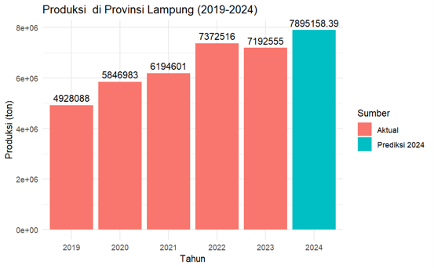

# 🌾 Cassava Production Forecasting in Lampung Province using Exponential Smoothing (ETS)

> **Proyek Analisis Time Series — Dinas Ketahanan Pangan, Tanaman Pangan dan Hortikultura Provinsi Lampung**  
> **Peneliti:** Ibnu Farhan Al-Ghifari

---

## 📌 Ringkasan Proyek

Provinsi Lampung merupakan produsen ubi kayu (singkong) utama di Indonesia. Fluktuasi hasil panen tahunan mempengaruhi ketersediaan bahan baku bagi industri pengolahan tapioka. Proyek ini bertujuan meramalkan total produksi ubi kayu Provinsi Lampung pada tahun 2024 menggunakan pendekatan **Time Series Exponential Smoothing (ETS)** berdasarkan data historis produksi.

---

## 📊 Dataset & Metodologi

- **Dataset**: Data historis produksi ubi kayu se-Provinsi Lampung rentang tahun 2019–2023.
- **Model**: Error, Trend, Seasonal (ETS) / Exponential Smoothing via library `forecast` R.
- **Target Peramalan**: Proyeksi total produksi tahun 2024[cite: 22, 24].

---

## 🏆 Hasil Evaluasi & Prediksi Model

Model Exponential Smoothing diuji menggunakan metrik evaluasi statistik terhadap baseline data aktual[cite: 22, 24]:

| Metrik Evaluasi | Nilai | Keterangan Performa |
|---|---|---|
| **MAPE** (Mean Absolute Percentage Error) | **9.77%** | **Sangat Baik** (< 10%) |
| **MAD** (Mean Absolute Deviation) | **702,603.40** | Unit kesalahan rata-rata dalam ton |
| **MSE** (Mean Squared Error) | **493,651,525.70** | Varian kesalahan |

### 📈 Hasil Peramalan Produksi 2024
- **Proyeksi Produksi Ubi Kayu 2024**: **7,895,158.39 Ton**
- **Tren**: Diproyeksikan mengalami peningkatan dari tahun-tahun sebelumnya untuk mendukung ketersediaan pangan dan pasokan industri daerah.

---

## 🛠️ Tech Stack & Library

- **Language**: R
- **Environment**: RStudio / R Markdown (`.Rmd`)
- **Libraries**:
  - `forecast`: Pembuatan model Time Series ETS
  - `readxl`: Import dataset Excel
  - `ggplot2`: Visualisasi grafik tren produksi

---

